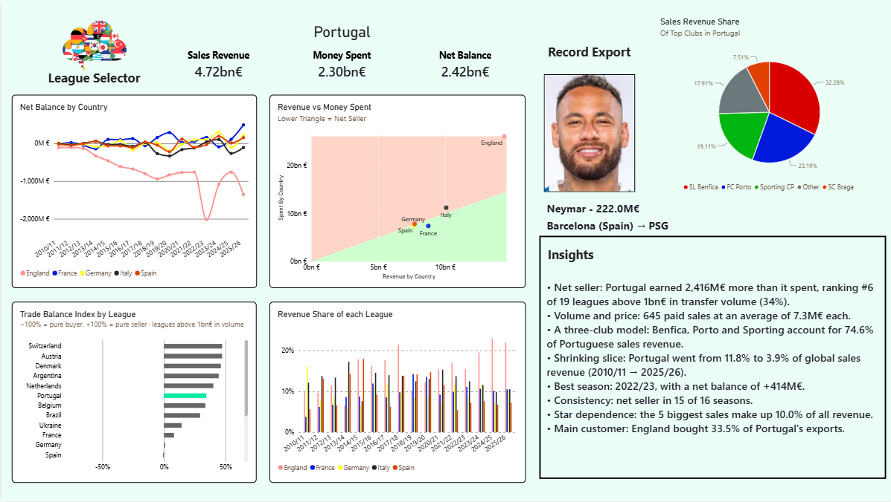
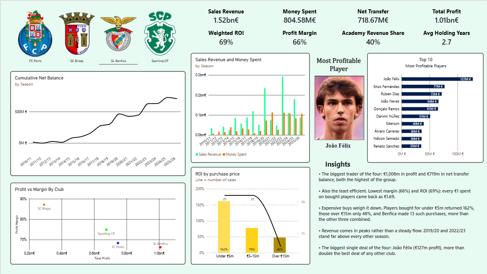
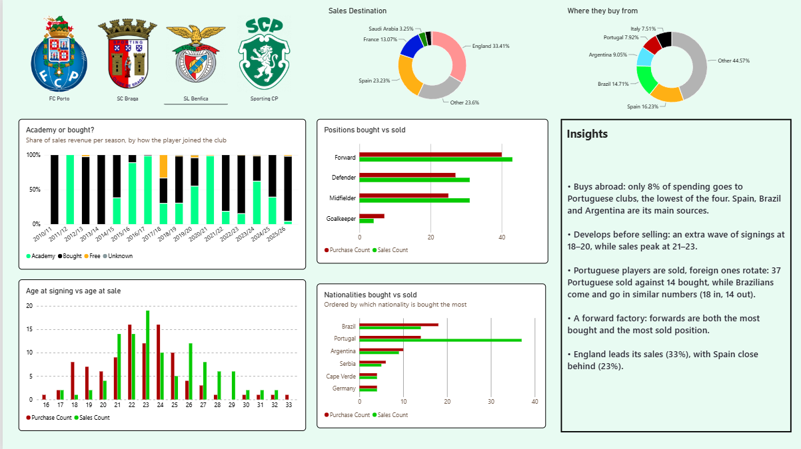

# Portuguese Football Transfers - Power BI

**Is the Portuguese "selling club" model real, is it sustainable, and what kind of player does Portugal sell at a profit?**

A solo Power BI portfolio project built on Transfermarkt data (2010/11–2025/26), focused on data modelling and DAX. It looks at Portugal as a league against 30 other leagues, then drills into Benfica, FC Porto, Sporting CP and SC Braga: how they make money, and who they buy and sell.



---

## Key findings

### The league

* **Portugal is a structural net seller.** €4.72bn in sales revenue against €2.30bn spent, a net balance of **+€2.42bn**, and a net seller in **15 of 16 seasons**.
* **Volume and surplus at the same time.** On the Trade Balance Index (net ÷ total volume), Portugal ranks **#6 of 19 leagues** with more than €1bn in transfer volume (+34%). The leagues ahead of it sell much less; Portugal's distinction is combining scale with surplus.
* **Not dependent on a handful of deals.** The 5 biggest sales account for only **10%** of Portuguese sales revenue.
* **In practice, a three-club model.** Benfica, Porto and Sporting account for **74.6%** of Portuguese sales revenue (82% with Braga).
* **A shrinking slice of a growing market.** Global transfer spend grew roughly 24x over the period, but Portugal's share of global sales revenue fell from **11.8% (2010/11) to 3.9% (2025/26)**. Revenue grew; the market grew faster.
* **England is the main customer**, buying **33.5%** of Portugal's exports.

### The clubs

|Club|Sales revenue|Spent|Net transfer|Total profit|Weighted ROI|Profit margin|Academy revenue share|Avg holding (bought)|
|-|-|-|-|-|-|-|-|-|
|SL Benfica|€1.52bn|€805m|€719m|€1.01bn|69%|66%|40%|2.7 years|
|FC Porto|€1.09bn|€655m|€440m|€747m|146%|68%|22%|3.2 years|
|Sporting CP|€902m|€509m|€392m|€675m|131%|75%|42%|2.3 years|
|SC Braga|€354m|€129m|€225m|€292m|136%|87%|54%|3.7 years|

* **Cheap buys return more, at every club with enough sales.** ROI on players bought for under €5m vs over €15m: Porto 327% vs 46%, Benfica 162% vs 48%, Sporting 298% vs 90%.
* **Benfica: the biggest trader and the least efficient.** Highest profit and net balance, lowest ROI and margin. It made 13 purchases over €15m that were later resold, more than the other three clubs combined (9).
* **Porto: the buy-and-resell club.** Best ROI (146%) and the lowest academy share (22%).
* **Braga: the academy club.** 54% of sales revenue from its own academy, an 87% margin, and 25 of its 27 bought-player sales cost under €5m. It receives 2.7x what it spends.
* **Sporting sells fastest**, with the shortest average holding of bought players (2.3 years).

### The players

* **England is the main destination** for Porto (38% of sales revenue), Benfica (33%) and Sporting (49%). **Braga is the exception**, selling mostly within Portugal (27%) and to Spain (25%).
* **Benfica buys abroad**: only 8% of its spending goes to Portuguese clubs. Brazil and Argentina are key sources for Porto and Benfica; Sporting buys at home (22%) and barely in Brazil (3%).
* **Portuguese players are mostly sold, not bought**: Sporting sold 39 and bought 17, Benfica 37 vs 14, Braga 23 vs 13.
* **Sporting sells youngest** (sales peak at 20). Porto signs players at 20–24 and sells them at 23–28.
* **Sporting changed model at the end of the decade**: academy players led sales revenue until 2018/19; since 2019/20 bought players lead most seasons.
* Across the whole market, **paid transfers peak at 22–23 years old**.

---

## The dashboard

|Page|Question|Main visuals|
|-|-|-|
|**1 — League**|How does Portugal compare with other leagues?|KPI cards, net balance by season, revenue vs spend scatter with break-even shading, Trade Balance Index ranking, revenue share by season, top-club share of Portuguese revenue, record export, dynamic insights, pop-up country filter|
|**2 — Club**|How does each club make money?|KPI cards, cumulative net balance, sales vs spend by season, profit vs margin by club, ROI by purchase price, most profitable player and top 10, dynamic insights|
|**3 — Profile**|Who does each club buy and sell?|Academy vs bought by season, age at signing vs age at sale, positions, nationalities, sales destinations, purchase origins, dynamic insights|

**Club page (Benfica)**



**Profile page (Benfica)**



---

## Data

* **Source:** [Football Data from Transfermarkt](https://www.kaggle.com/datasets/davidcariboo/player-scores) (Kaggle, `davidcariboo/player-scores`), maintained by a public pipeline and updated weekly. This project uses version 679.
* **Tables used:** `transfers` (99k+ rows), `players`, `clubs`, `competitions`. `player_valuations` is loaded for a future version.
* **Scope:** 01/07/2010–30/06/2026 (16 full seasons). Rows after 30/06/2026 (~1,000 pre-agreed deals) were removed.
* **Transformations (Power Query):** players reduced to 6 columns (id, name, date of birth, position, sub-position, citizenship), competitions filtered to domestic leagues, position labels renamed (Attack → Forward, Midfield → Midfielder).

---

## Data model

Star schema with `transfers` as the fact table.

* **Dimensions:** `players`, `clubs`, `competitions` and a DAX date table (`Dates`, seasons running July–June).
* **Two relationships between `clubs` and `transfers`:** seller side (`from_parent_id`, active) and buyer side (`to_parent_id`, inactive, switched on with `USERELATIONSHIP` in the buy-side measures).
* **`ClubParents`:** a manual mapping of 27 club IDs (main teams, B teams and youth teams) to the four parent clubs, so academy promotions and B-team sales roll up to the right club. Text matching was unusable ("Sporting" alone matches Sporting Macau, Osasco Sporting and others).
* **`Countries`:** a disconnected table, so revenue (seller country) and spend (buyer country) can share one axis.
* **`_Measures`:** a dedicated table for all measures.

### Buy–sell pairing

The core of the project is matching each sale to the purchase of the same player, using calculated columns on `transfers` (the link between a sale and its purchase is a fixed property of the row and must not change with slicers):

* `movement_type`, `is_internal_move`, `is_loan_out`, `is_loan_return`: separate real market moves from academy promotions and loans (zero-fee moves between the same two parent clubs, in reverse direction, within 800 days).
* `is_sale`: a paid transfer whose seller is one of the four clubs.
* `buy_date`, `buy_fee`: the most recent real entry of the same player into the same parent club before the sale.
* `sale_origin`: Academy (no purchase, or joined before 18), Bought, Free or Unknown.
* `profit`, `holding_days`, `roi_annualized`, `buy_bracket`.

Validated case by case against Transfermarkt: Essugo (academy), Darwin Núñez (€34m purchase, 665 days), Cristiano Ronaldo (€2k at 12, academy by the age rule), Palhinha, João Mário, Otávio and others.

---

## Metric definitions

|Metric|Definition|
|-|-|
|Sales Revenue / Money Spent|Sum of transfer fees received / paid|
|Net Transfer|Sales revenue − money spent in the period. A cash view, with no link between sales and purchases|
|Total Profit|For each player sold: sale fee − that player's own purchase cost. Academy players count as zero cost|
|Weighted ROI|Total profit ÷ total cost, **bought players only**, value-weighted (bigger deals weigh more). Not time-adjusted|
|Profit Margin|Total profit ÷ sale revenue, all sales (academy sales push it up)|
|Avg Holding Years|Average time between purchase and sale, bought players only|
|Academy Revenue Share|Share of sale revenue coming from academy players|
|Trade Balance Index|Net balance ÷ (revenue + spend), from −100% (pure buyer) to +100% (pure seller)|
|Revenue Share|A country's sales revenue ÷ global sales revenue|

**Net Transfer vs Total Profit:** players bought but never resold count as spend in Net Transfer but never enter Total Profit, and a player bought before 2010 and sold inside the window enters Total Profit with his original cost. Net Transfer is how much cash was left; Total Profit is how much was earned on the players actually sold.

---

## Technical highlights

* **Role-playing relationships** with `USERELATIONSHIP` (seller vs buyer side) and a disconnected dimension filtered with `IN VALUES()`.
* **`KEEPFILTERS`** in the profit and ROI measures, so measure filters intersect with visual filters instead of replacing them.
* **Dynamic text insights** on every page: `SWITCH` for the wording, every number pulled from measures. On page 1 the text follows the country selected in the slicer (net seller / net buyer wording switches with the data).
* **Homonym-safe player labels:** the player ID is encoded into the name as invisible zero-width characters (22 bits), so two players with the same name never merge, without showing the ID.
* **Pop-up filter panel** built with bookmarks and the selection pane.
* **Ranking with a volume threshold** (`RANKX` over leagues above €1bn in volume) kept consistent between the chart and the insight text.

---

## Limitations

* Only ~18% of transfers have a fee above zero. Fees are Transfermarkt's reported figures, often estimates.
* The `clubs` table covers 32 domestic leagues (top divisions only). Transfers involving lower divisions or other leagues have no country (~6% of total value). In purchases this is significant for Porto, Braga and Sporting, and part of it is Portuguese lower-league clubs.
* A club's country comes from its current league, so a relegated club can be misassigned in earlier seasons.
* Academy players have a cost of zero. Real academy costs (staff, facilities, wages) are not in the data, so ROI is calculated for bought players only.
* Purchases with an unknown fee are excluded from ROI.
* All values are nominal: no adjustment for inflation or for market growth (~24x over the period).
* Weighted ROI ignores time; annualized ROI is only shown per player.
* Loan detection and the academy rule (joined before 18) are heuristics, validated on test cases but not exhaustive.
* Some price brackets rest on very few sales (Braga has 2 sales of players bought for €5–15m and none above €15m).

---

## How to open

1. Download the dataset from [Kaggle](https://www.kaggle.com/datasets/davidcariboo/player-scores) and place the CSV files in `data/`.
2. Open the report in Power BI Desktop. If it is the `.pbit` template, Power BI asks for the data folder and loads it.
3. If the file paths differ, update them in Transform data → Data source settings, then refresh.

## Inside PowerBI

1. While navigating through the leagues, if you choose one specific league, it will show its insights and KPIs. If you select multiple, it shows Portugal's by default.
2. All countries represent their biggest leagues (England -> Premier League; Italy -> Serie A; etc), any secondary league is put under "Others".

```
portuguese-football-transfers/
├── data/      # Kaggle CSVs (not included)
├── pbix/      # Power BI report
├── docs/      # notes
└── images/    # screenshots
```

---

## Next steps (v2)

* Market value two years after the sale, as a proxy for whether the buyer got a good deal.
* A detail page with every transfer, reachable by drill-through.
* Market-adjusted profit (fees indexed to the season's median paid fee).
* Extending the parent-club mapping to foreign clubs.

---

**Author:** Martim Coelho - Information Management, NOVA IMS. Built for self training and interest purposes
